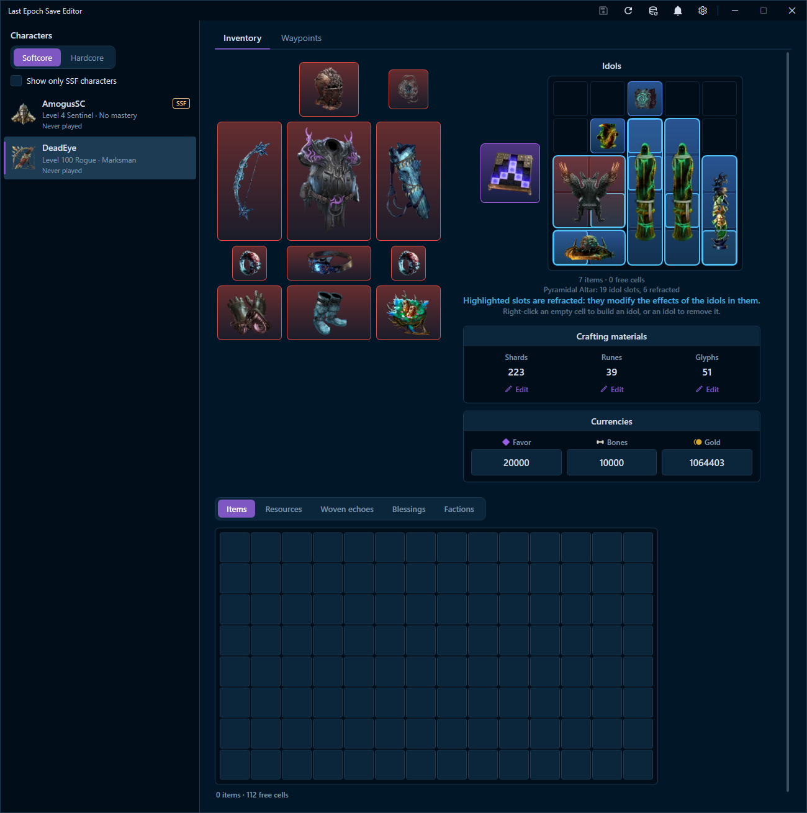
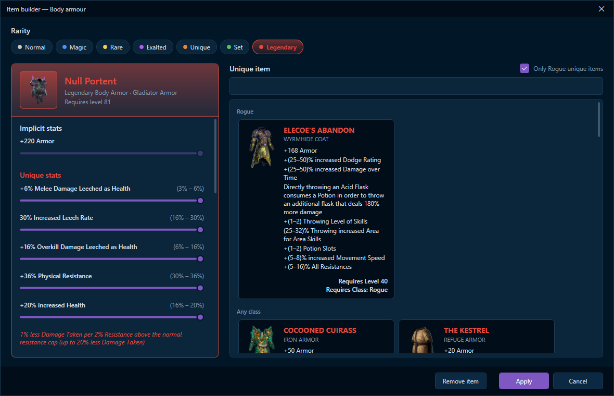
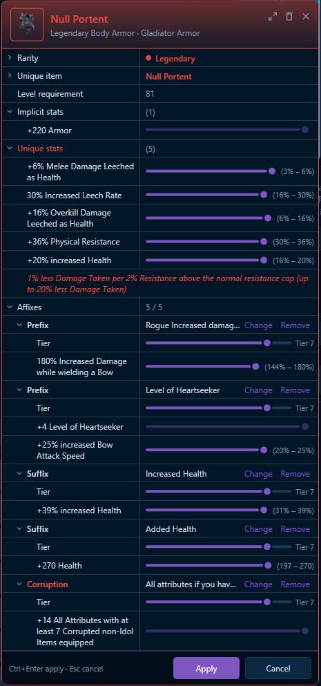
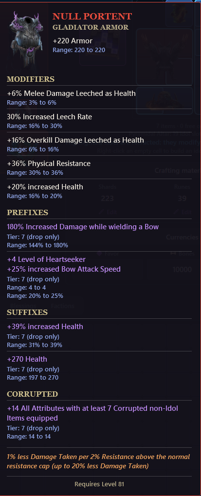
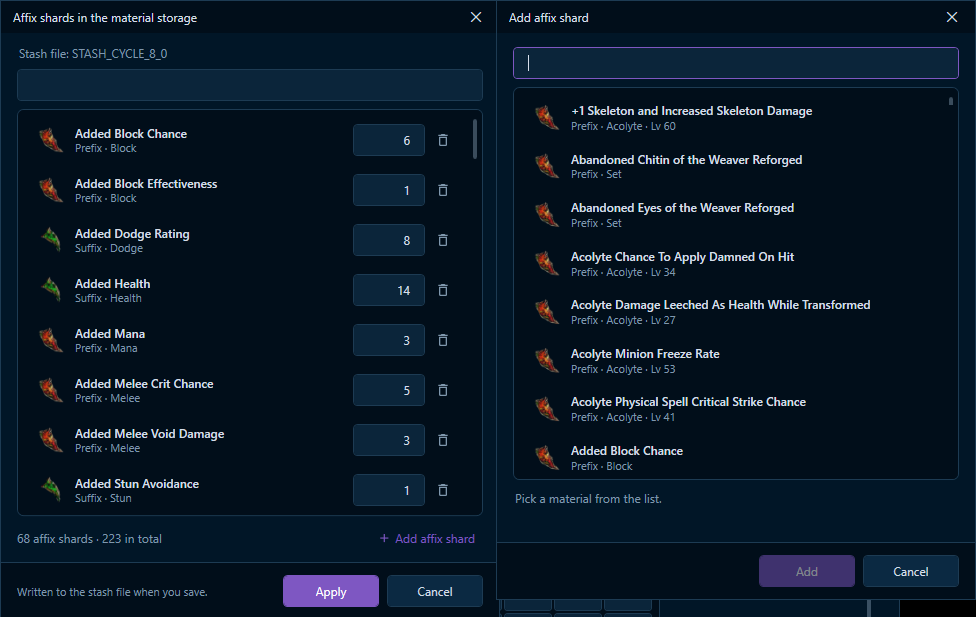
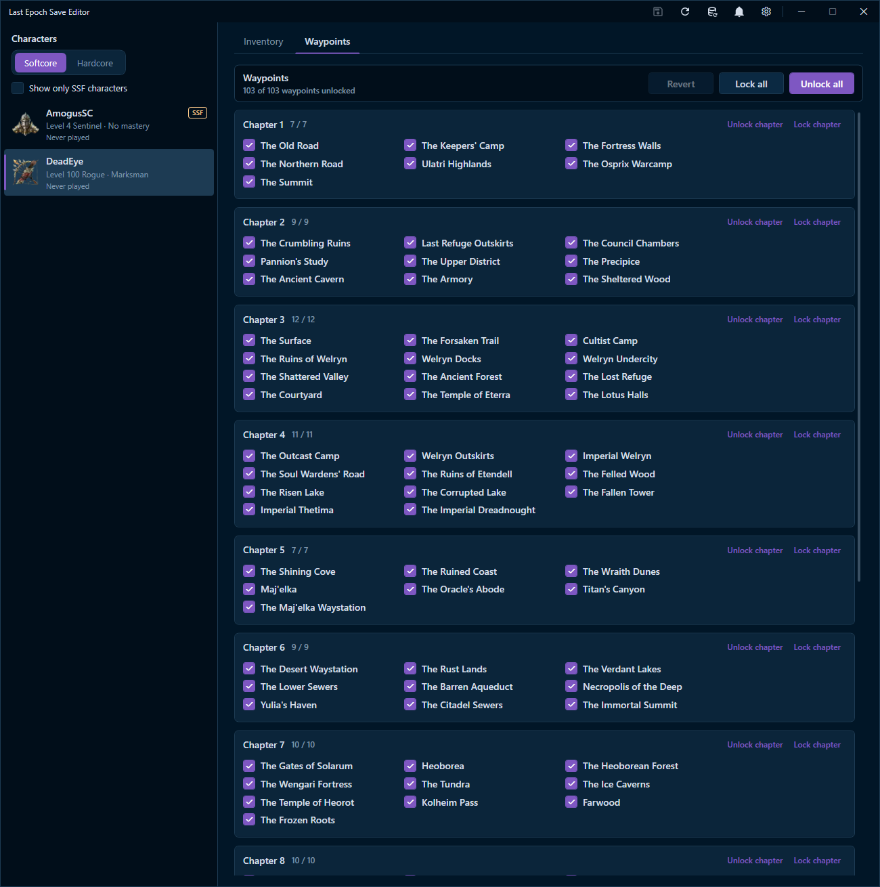
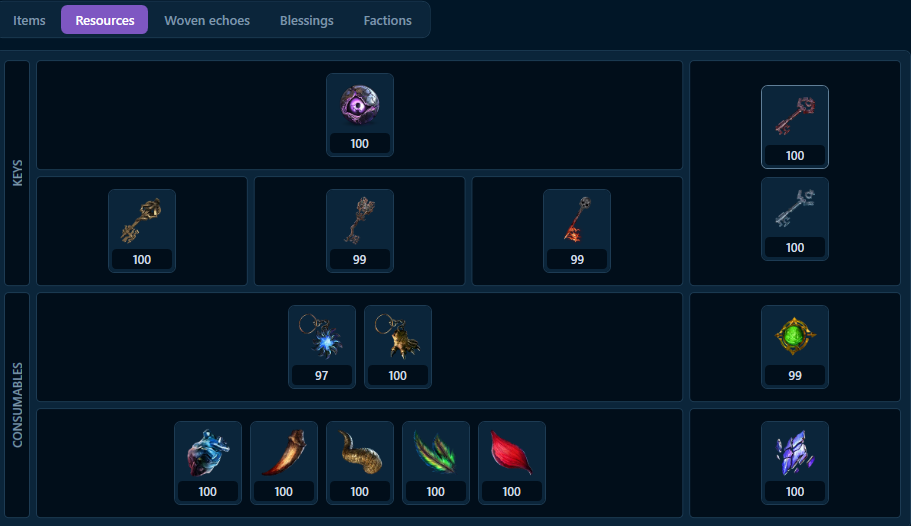
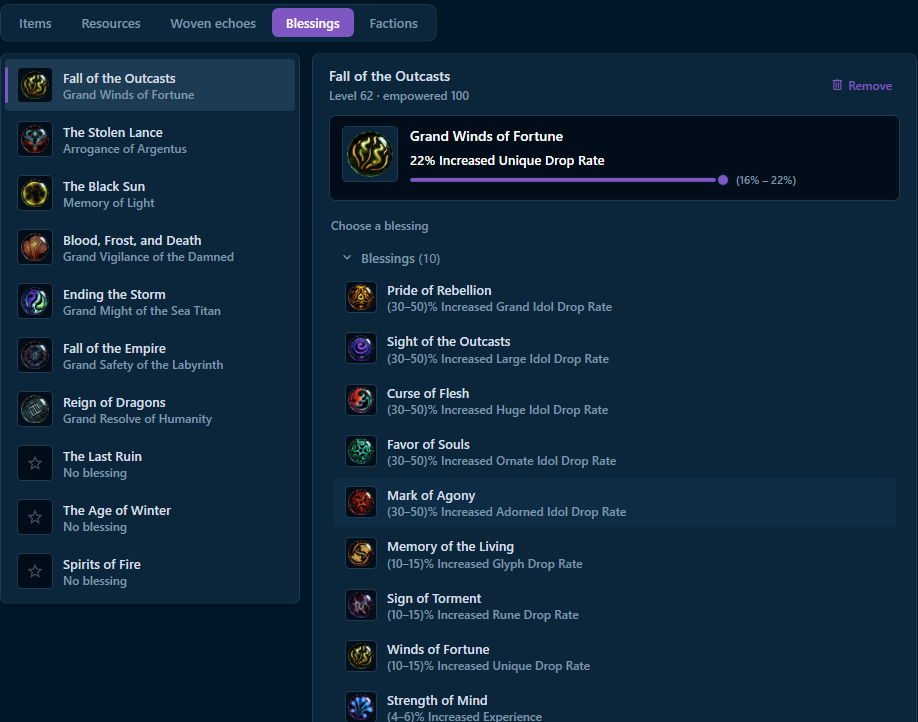
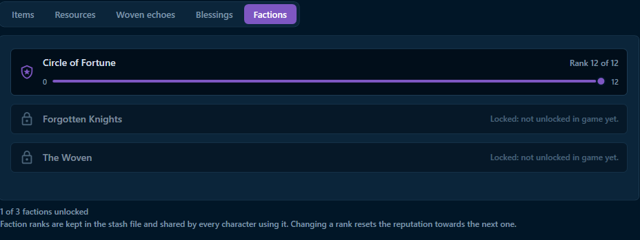

# Last Epoch Save Editor

<p align="center">
  <a href="https://github.com/IgorBabayan/le-save-editor/releases"></a>
  
  
  <a href="LICENSE"></a>
</p>

**Last Epoch Save Editor** is a Windows desktop application for editing **offline** [Last Epoch](https://lastepoch.com/) character saves. Inspect and create equipment, tune item affixes, manage idols and stash materials, adjust resources and faction ranks, choose blessings, and unlock waypoints—all in a game-inspired interface.

> [!IMPORTANT]
> **Offline characters only.** This application does not edit server-side online characters. **Exit Last Epoch before modifying saves**, and keep a separate backup of your save folder. Editing saves can cause unexpected behavior after game updates.

<p align="center">
  
</p>

<p align="center">
  <a href="https://github.com/IgorBabayan/le-save-editor/releases">Download releases</a> ·
  <a href="#features">Explore features</a> ·
  <a href="#screenshots">View screenshots</a> ·
  <a href="#building-from-source">Build from source</a> ·
  <a href="https://github.com/IgorBabayan/le-save-editor/issues">Report an issue</a>
</p>

## Features

### Characters and inventory

- Browse offline **Softcore** and **Hardcore** characters; optionally filter to **SSF** characters.
- View equipped gear, the character's backpack, idol grid, idol altar, and shared stash-related data.
- Click equipment, backpack items, or idols to open the item editor.
- Drag items within the backpack or idol grid, and remove unwanted items.
- Right-click an empty backpack or idol cell to create an item.
- Work with **Normal, Magic, Rare, Exalted, Unique, Set, and Legendary** equipment.

### Powerful item editor and builder

- Build items from the game database with a searchable selection of item bases and uniques.
- Change item rarity, unique base, implicit values, and eligible affixes.
- Edit **prefixes, suffixes, corruption**, affix tiers, and stat rolls with sliders.
- Preview item details and roll ranges in a game-style tooltip.
- Work with **unique and legendary items**, including their special modifiers.
- Edit idols, including supported **Weaver**, **Heretical**, and **Unique** idols.
- Configure **idol altars**, their layouts, and **refracted slots**.

### Stash, crafting, and currencies

- Edit quantities of **affix shards, runes, and glyphs** in stash material storage.
- Add or remove materials using the searchable game-data catalog.
- Manage keys and consumable resources, including dungeon and arena keys.
- Adjust displayed currencies such as **Gold**, **Favor**, and **Bones**.
- Edit supported runes, glyphs, and other resources stored directly in the backpack.

> [!NOTE]
> Some values are stored in a **shared stash file**, not in an individual character file. Changes to shared materials, resources, and faction ranks can affect other offline characters using that stash.

### Progression and customization

- **Waypoints:** toggle individual waypoints, unlock or lock an entire chapter, or unlock/lock all waypoints.
- **Blessings:** choose Monolith timeline blessings, including Grand blessings, and adjust their rolls.
- **Factions:** inspect faction unlocks and edit ranks for factions that are already unlocked in-game.
- **Woven echoes:** access the dedicated Woven echoes inventory section.
- **Idols:** view and edit placements, including altar-specific blocked and refracted cells.

### Save protection and updates

- **Automatic timestamped backups** when saving, with the five most recent backups retained.
- **Atomic writes** through a temporary file, reducing the risk of partially written saves.
- **External-change detection:** saving is blocked if the game or another process modified the file after it was loaded.
- **Preservation of unrelated save data:** the editor changes only the relevant item entries and retains fields it does not recognize.
- **Unsaved-change prompts** when reloading or closing the app.
- **Automatic update support** for installer-based releases, plus a manual update check in Settings.

## Screenshots

<details>
<summary><strong>Item builder — create equipment and adjust rolls</strong></summary>

<p align="center"></p>

</details>

<details>
<summary><strong>Item inspector and detailed tooltip</strong></summary>

<p align="center">
  
  
</p>

</details>

<details>
<summary><strong>Crafting materials — shards, runes, and glyphs</strong></summary>

<p align="center"></p>

</details>

<details>
<summary><strong>Waypoints — individual, chapter, and global controls</strong></summary>

<p align="center"></p>

</details>

<details>
<summary><strong>Stash resources — keys and consumables</strong></summary>

<p align="center"></p>

</details>

<details>
<summary><strong>Timeline blessings</strong></summary>

<p align="center"></p>

</details>

<details>
<summary><strong>Faction ranks</strong></summary>

<p align="center"></p>

</details>

## Getting started

### Download and install

1. Open the [**Releases**](https://github.com/IgorBabayan/le-save-editor/releases) page.
2. If a release is available, download the Windows installer named `LE.SaveEditor-Setup-<version>.exe`.
3. Run the installer and launch **LE Save Editor**.
4. Close Last Epoch before making edits; ensure the editor is using the intended **offline save folder**.
5. Select a character, make your changes, and press **Ctrl+S** or the save icon.

The release installer is **self-contained**, so a separate .NET runtime is not required. The desktop application itself is **Windows-only** (WPF).

### Where are the saves?

The usual Windows save directory is:

```text
%USERPROFILE%\AppData\LocalLow\Eleventh Hour Games\Last Epoch\Saves
```

Paste the path into File Explorer's address bar to open it. Character saves normally use names beginning with `1CHARACTERSLOT_`, while stash files use names such as `STASH_CYCLE_...`.

**Recommended workflow:** copy the *entire* `Saves` directory somewhere safe before your first edit. This also protects you against game updates and Steam Cloud synchronization conflicts.

### Everyday controls

| Action | Control |
| --- | --- |
| Save current character | **Ctrl+S** or the title-bar save icon |
| Reload saves from disk | **F5** or the title-bar reload icon |
| Edit an item | Click an equipped item, backpack item, or idol |
| Create a backpack item or idol | Right-click an empty compatible cell |
| Move a backpack item or idol | Drag it to a free space |
| Remove an item | Trash icon or **Remove** in the item menu/editor |
| Update the game database | Database icon in the title bar |
| Check for application updates | **Settings → Updates → Check for updates** |

## Building from source

### Prerequisites

- **Windows x64** with the **.NET 10 SDK** installed.
- Git, or a downloaded copy of this repository.
- Optional: **Inno Setup 6** to package a Windows installer.

```powershell
git clone https://github.com/IgorBabayan/le-save-editor.git
cd le-save-editor

# Restore, compile, and launch the WPF application
dotnet restore .\LE.SaveEditor\LE.SaveEditor.csproj
dotnet run --project .\LE.SaveEditor\LE.SaveEditor.csproj
```

The editor's local build process also builds and copies the companion database generator into `Tools\LE.SaveEditor.DB`.

### Publish a self-contained build

```powershell
# Publish the desktop editor
dotnet publish .\LE.SaveEditor\LE.SaveEditor.csproj `
  -c Release -r win-x64 --self-contained true -o .\publish

# Publish the bundled database generator
dotnet publish .\LE.SaveEditor.DB\LE.SaveEditor.DB.csproj `
  -c Release -r win-x64 --self-contained true `
  -o .\publish\Tools\LE.SaveEditor.DB
```

Launch `publish\LE.SaveEditor.exe`. The repository's [release workflow](.github/workflows/release-installer.yml) additionally uses Inno Setup to create the distributable installer.

### Automated releases

When a pull request is **merged into `release`**, the GitHub Actions release workflow publishes a self-contained `win-x64` build, packages it using `installer/LE.SaveEditor.iss`, and attaches the installer to a tagged GitHub Release. The version's major and minor components are defined in `LE.SaveEditor/LE.SaveEditor.csproj`; the CI run number provides the build component.

## Game database

The editor uses a local SQLite database to identify item bases, uniques, affixes, icons, and other game content. The companion **`LE.SaveEditor.DB`** tool builds and updates this database from [Maxroll's Last Epoch planner data](https://maxroll.gg/last-epoch/planner/).

- **Database and settings:** `%APPDATA%\LE.SaveEditor\` (`base.db` and `settings.json`).
- **Game icons:** cached PNG files in `%APPDATA%\LE.SaveEditor\Icons\`.
- **Database update:** use the database button in the application title bar. If no database is present, the update action can build one.
- **Manual generator usage:** `LE.SaveEditor.DB --run build` or `LE.SaveEditor.DB --run update` (optionally `--config <folder>`).

Game data and icon availability depend on the upstream planner data and the current database version.

## How saving works

The editor writes character changes to the corresponding `1CHARACTERSLOT_*` save file and stash-backed changes to the appropriate `STASH_*` file. It preserves unknown fields and unchanged item data where possible.

Before replacing a file, it creates a timestamped backup beside it:

```text
<save-file-name>.yyyyMMdd-HHmmss.bak
```

The editor keeps the **five most recent** automatic backups for each file. If a file was modified on disk after being loaded, the editor refuses to overwrite it; reload the saves and retry after closing the game.

> [!WARNING]
> Automatic backups are a safety net, **not a substitute for your own backup**. Keep a copy of the full save directory before experimenting with powerful or unusual item combinations.

## Project structure

```text
le-save-editor/
├── LE.SaveEditor/           # .NET 10 / WPF desktop application
├── LE.SaveEditor.DB/        # SQLite game database generator and icon processing
├── installer/               # Inno Setup Windows installer
├── .github/workflows/       # Build and release automation
├── docs/screenshots/        # Screenshots referenced in this README
├── LICENSE                  # MIT license
└── README.md
```

## Contributing and feedback

Found a bug, missing item, incorrect stat roll, or incompatibility after a Last Epoch update? Please [open an issue](https://github.com/IgorBabayan/le-save-editor/issues) with the app version, game version, reproduction steps, and any non-sensitive logs or screenshots. Do **not** publish private save files without reviewing them first.

Contributions and pull requests are welcome. For changes to item definitions or icons, include the source and game version when possible.

## License and disclaimer

This project is released under the **[MIT License](LICENSE)**. Copyright © 2026 Igor Babayan.

**Last Epoch** and its in-game names, artwork, and assets belong to their respective owners. This is an independent fan-made tool and is **not affiliated with or endorsed by Eleventh Hour Games**. Third-party game data and imagery are subject to their own rights and terms.
